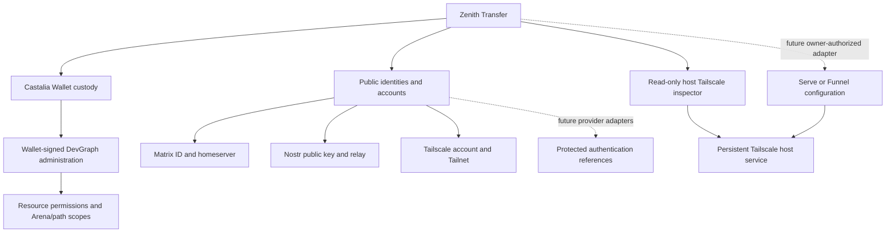

# Identity and account boundaries

Transfer owns the native UI. Castalia owns Wallet custody and exact-consent signing.
An account record associates a public provider identity with one Castalia public
key locally; this association is not proof of ownership or a server credential.

Private keys/sessions are not stored in account metadata. Tailscale node state
remains with its persistent service; quitting Transfer does not stop it. Graph
authorization is independent of Matrix, Nostr and Tailscale account authentication.
The read-only host inspector invokes the fixed Tailscale application executable
with `TAILSCALE_BE_CLI=1`, as specified in the [Tailscale CLI documentation](https://tailscale.com/docs/reference/tailscale-cli).
This selects command-line mode from a graphical Transfer launch; it changes no
Tailnet, Serve or Funnel configuration. A failed observation is not evidence that
the service is disconnected.
Transfer groups DevGraph interfaces under one graph service and manages its combined inbox through protected local secS RPC. HTTPS remains an access point for remote clients. Signed route bindings, receiver restrictions and pending action recovery remain exact; see [Shared service access](canonical-service-access.md).
