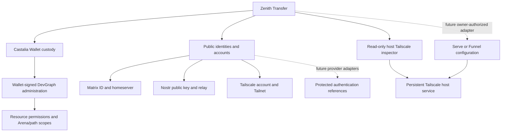

# Identity and account boundaries

Transfer owns the native UI. Castalia owns Wallet custody and exact-consent signing.
An account record associates a public provider identity with one Castalia public
key locally; this association is not proof of ownership or a server credential.

Private keys/sessions are not stored in account metadata. Tailscale node state
remains with its persistent service; quitting Transfer does not stop it. Graph
authorization is independent of Matrix, Nostr and Tailscale account authentication.
Local secS RPC and remote HTTPS retain their separately bound service selection.
