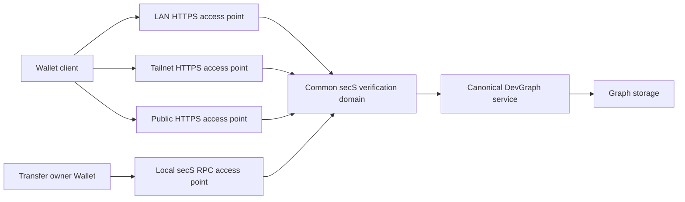

# Provider and canonical-service credentials

Status: corrected target contract. This document supersedes the per-origin
credential partitioning in the earlier endpoint plan. It does not change the
installed URL-bound protocols, signatures, grants or pending actions.

## Identity and transport

| Concept | Meaning | Authority consequence |
| --- | --- | --- |
| Provider | The trusted authority responsible for a service, with authenticated signing-key ownership and rotation | Determines which issuer keys may issue credentials for that service |
| Canonical service | A stable logical service identity under that provider, independent of a process, host, port or URL | The credential audience and resource namespace |
| Access point | An owner-authorized route to the canonical service: local RPC, LAN HTTPS, Tailnet HTTPS or public HTTPS | Supplies reachability and channel verification; does not mint another service identity |
| Credential | Authority for a recipient Wallet, canonical service, operations, resources, validity and applicable installation constraints | The same credential authorizes the same permitted operation through every admitted access point |
| secS verification domain | The common policy, trust, revocation and replay authority serving that canonical service | Applies the same authorization rules regardless of the route used |

One provider may operate several canonical services. A grant for one DevGraph
does not authorize another graph, even if their Arena names match. Sharing a
provider key, hostname, database identifier or issuer label alone does not prove
that two deployments are the same canonical service. Canonical identity and
authorized issuer keys need an authenticated binding rooted in owner/provider
authority. The exact wire identifier format is to be allocated jointly with
DevGraph, secS and Wallet; this document does not allocate a schema version.

The diagram shows logical boundaries. Several processes can implement the access
points; they must still use the same authoritative service policy and state.
Network exposure does not make an owner/admin operation available to public
clients. Member and host-administration capabilities remain distinct.

## Verification invariants

Credential issuance, presentation and secS authorization bind provider identity,
canonical service identity, the recipient and permitted actions/resources. They
do not use the selected URL as the credential audience or grant namespace.
Different transport routes must not require separate grants, approval decisions,
credential imports or Wallet identities for the same service and authority.

Each connection still authenticates its transport and destination. HTTPS checks
the hostname/certificate; local RPC checks its protected registration and pinned
implementation. A client verifies that an access point is authorized to represent
the expected canonical service before presenting a credential. An arbitrary URL
cannot declare itself an alias and receive credentials. Discovery alone is not
proof, and this change does not permit disabling TLS checks or ignoring Host and
Origin checks.

Fresh proofs bind the canonical service, operation, nonce and exact request.
Browser caller-origin checks and destination disclosures remain separate
anti-phishing/channel safeguards; they do not turn each origin into a separate
credential authority. Merely changing an access point cannot broaden a grant.
An access point may expose fewer routes or require network admission, while secS
continues to evaluate the same service-scoped credential.

The service has one logical request inbox, grant/revocation state, policy history,
challenge-consumption authority and write idempotency/result history. Endpoint
metadata may record where a request arrived. Reusing a consumed proof or retrying
a committed write through another access point must not execute it twice.
Revocation and policy changes must take effect coherently across all access points;
independent per-route stores or stale caches cannot silently preserve authority.
Distributed implementation requires transactional coordination, not merely copies
of the same configuration or replication of grants.

Adding, removing or replacing a network route changes service availability and
transport trust, not the underlying credential. Genuine provider/service/key
changes require their own authenticated change and migration rules.

## Transfer and Wallet experience

Transfer shows a canonical service once, with its access points underneath it.
The service contains Credentials & requests, owner administration and permission
presets. Sharing & network manages its routes separately. Selecting a preferred
route does not select another inbox or change the permission editor.

Wallet stores the credential under provider + canonical service. Scope choices
remain explicit: all permitted Work or selected Arena/Initiative/Project branches
and their current descendants at access time. Installation constraints remain
independent of the route. Onward delegation remains disabled.

## Current coupling to replace

| Surface | Current behavior | Required change |
| --- | --- | --- |
| `WorkAccessConfiguration`, `RegisteredResource` | HTTPS receiver/origin serves as resource identity | Separate canonical service/authority from selectable transport profiles |
| `LocalServiceDiscovery` | Interface instance identity derives from resource + interface + endpoint | Keep route/instance identity for discovery and protected dispatch, grouped under stable service identity |
| `LocalAdminRPC` | Receiver/profile pins protect exact selected endpoint and wire envelopes | Retain local implementation/route checks; carry and verify canonical authority independently |
| `NativeOperatorClient`, `OperatorJournal` | Inbox, consent and original-action recovery bind URL receiver | New service-scoped contracts and journals, retaining route provenance without creating another authority domain |
| DevGraph `owner_endpoint`, runtime factory | Secondary origin gets distinct request/enrollment/grant/replay state | Authorized access points compose the same canonical service authorization state |
| DevGraph request, draft, enrollment and write contracts | Legacy signed receiver fields include the endpoint URL | Versioned canonical service audience across producer, verifier and clients |
| Wallet/secS signing and verification | Existing receiver-bound transcripts and credential checks | Matched canonical service transcripts and verification, preserving nonce, operation and request integrity |

## Migration order

1. Inventory all signed and persisted contracts in DevGraph, secS, Wallet,
   Transfer, browser and iOS clients. Allocate one shared canonical identity and
   access-point binding contract; do not introduce a Transfer-only interpretation.
2. Implement the service-side verification domain and shared transactional
   authorization/replay state. Add explicit versioned contracts and shared golden
   vectors before exposing new client behavior.
3. Update Wallet/secS verification, then Transfer/browser/iOS readers and issuers.
   Keep legacy decoders and their exact semantics during the transition.
4. Qualify multiple admitted access points against the same service and grant.
   Only then switch discovery and UI grouping to the new model.
5. Migrate existing grants through an authenticated, reviewed reissuance or explicit
   grant-migration mechanism with unchanged-or-narrower authority. Preserve owner
   registration, revocations, audit and original-action recovery. Until-revoked
   validity must not become an arbitrary new expiry.

Existing URL-bound signed credentials and pending actions cannot be rewritten or
declared portable by changing a string. Do not merge endpoint databases, broaden
receiver acceptance or disable installed URL verification as a shortcut. Old
uncertain actions must be recovered under their original signed contract.

## Acceptance requirements

- One service-scoped credential works for identical permitted reads and writes
  through LAN, Tailnet, public HTTPS and local RPC where those routes expose the
  operation. Switching routes needs no second grant decision.
- A different canonical service/provider, unauthorized alias, changed issuer key,
  bad certificate or altered request is rejected.
- Existing scope, excluded resources, installation constraints and disabled
  delegation remain enforced through every route.
- A grant or revocation is observed consistently across routes. One logical inbox
  and approval history remain visible in Transfer.
- A proof consumed on one route is rejected on another. A write retried through
  another route with its original idempotency identity returns its original result
  and does not execute twice, including concurrent attempts.
- Route addition/removal and certificate/hostname changes do not change service
  authority; authorization-policy changes remain separately reviewed.
- Legacy credentials, locked Wallet state, restart and uncertain original-action
  recovery retain their original versioned semantics during migration.

These are implementation requirements, not claims that the installed build
already implements service-scoped credentials across access points.
